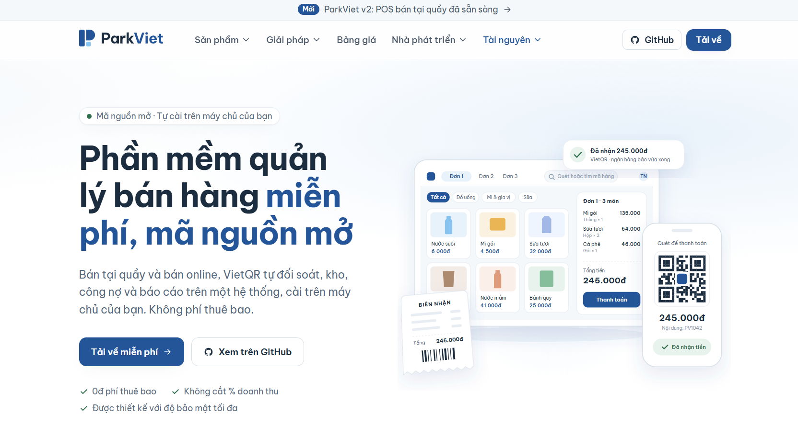

# ParkViet

**Phần mềm bán hàng cho cửa hàng, quán ăn và doanh nghiệp Việt Nam.** Website: [parkviet.com](https://parkviet.com)

ParkViet giúp người bán quản lý việc bán tại quầy, bán online, kho hàng, công nợ và báo cáo trên cùng một hệ thống. Hệ thống được làm theo cách kinh doanh của người Việt: thu tiền bằng mã VietQR, ghi nợ cho khách quen, nhận đơn qua Facebook và Zalo, giao hàng cho cư dân, in hóa đơn điện tử, bán theo bàn, theo giờ và theo suất ăn.

<p align="center">
  <a href="https://parkviet.com">
    
  </a>
</p>

## Vì sao chọn ParkViet?

- **Miễn phí 100%, mọi tính năng.** Không có gói trả phí, không khóa tính năng, không giới hạn số chi nhánh, quầy, nhân viên hay đơn hàng.
- **Mã nguồn mở.** Toàn bộ mã nguồn công khai tại [github.com/parkviet/parkviet](https://github.com/parkviet/parkviet). Ai cũng xem được hệ thống làm gì với dữ liệu của mình.
- **Tự do phát triển thêm.** Mỗi ngành hàng, mỗi đơn vị có cách bán riêng. Bạn được sửa và bổ sung tính năng cho đúng nhu cầu của mình, không phải chờ nhà cung cấp.
- **Được hỗ trợ miễn phí.** Hỏi đáp, hướng dẫn cài đặt và sử dụng không mất phí. Liên hệ qua [parkviet.com](https://parkviet.com) hoặc mở issue trên GitHub.
- **Dữ liệu là của bạn.** Cài trên máy chủ của quán (mạng LAN) hoặc VPS riêng. Đơn hàng, khách hàng và công nợ nằm trên máy của bạn, không gửi về bên thứ ba.
- **Bảo mật thật sự, không chỉ là lời hứa.**
  - Phân quyền theo từng chi nhánh và từng việc: thu tiền, bán chịu, trả hàng, xem báo cáo… Nhân viên chỉ thấy và làm được phần được giao.
  - Thao tác về tiền (thu chi két, ghi nợ, hoàn tiền, xóa món đã gửi bếp) cần người có quyền duyệt và đều được ghi nhật ký.
  - Các tính năng có rủi ro mặc định tắt, chủ cửa hàng tự bật khi cần.
  - Mã nguồn công khai nên ai cũng kiểm tra được, và mỗi lần thay đổi đều phải qua bộ kiểm thử tự động.
- **Vibecode mà không làm hỏng tính năng.** Mỗi thư mục trong dự án có file hướng dẫn (`AGENTS.md`) cho các công cụ AI viết code như Claude Code, Cursor, Codex. File này chỉ cách chạy, những quy tắc không được phá và test nào cần chạy. Hơn 2.600 bài kiểm thử tự động chạy trên GitHub mỗi lần đẩy code, nên tính năng có sẵn bị hỏng hay lỗ hổng phân quyền mới đều bị phát hiện trước khi đưa vào dùng. Xem [Dành cho lập trình viên](#dành-cho-lập-trình-viên).

## Sản phẩm

| Ứng dụng | Dành cho ai | Làm được gì |
| --- | --- | --- |
| **ParkViet POS** (`apps/pos`) | Thu ngân | Bán tại quầy, thu tiền, ghi nợ, trả hàng, đóng ca, in phiếu. Chạy trên trình duyệt, máy tính bảng hoặc máy POS. |
| **Quản trị POS** (`apps/pos-dashboard`) | Chủ cửa hàng, quản lý | Thiết lập cửa hàng theo ngành, chi nhánh, quầy, nhân viên và quyền, thực đơn, máy in, thiết bị, mẫu phiếu, hóa đơn điện tử, báo cáo. |
| **ParkViet Nhân viên** (`apps/pos-staff`) | Phục vụ, bếp, chủ quán | App di động (Flutter) với các chế độ máy phục vụ, màn bếp, trạm in, kiosk tự gọi món và app chủ quán (duyệt từ xa, cảnh báo, xem đơn đang mở). |
| **Gọi món bằng QR** (`apps/table-order`) | Khách tại bàn | Khách quét mã QR trên bàn, xem thực đơn và gửi món xuống bếp, không cần cài app. |
| **Website bán hàng** (`apps/storefront`) | Khách mua online | Cửa hàng trực tuyến cho người bán. |
| **Cổng bán sỉ** (`apps/storefront`, trang `/wholesale`) | Đại lý, khách mua sỉ | Đăng ký tài khoản sỉ chờ duyệt, xem giá sỉ sau khi đăng nhập, đặt nhanh theo mã hàng, giỏ hàng sỉ riêng. |
| **Bảng người bán** (`apps/seller-dashboard`) | Người bán trên sàn | Mỗi người bán tự quản lý sản phẩm và đơn hàng của mình khi chạy mô hình sàn nhiều người bán. |
| **Bảng quản trị** (`apps/dashboard`) | Quản lý bán hàng online | Sản phẩm, đơn hàng, khách hàng, kho, khuyến mãi, bảng giá theo nhóm khách và quy cách đặt hàng sỉ cho từng mặt hàng. |

## POS hỗ trợ những ngành nào?

Khi thiết lập cửa hàng, chủ cửa hàng chọn ngành. ParkViet tự bật các chức năng mà ngành đó cần và gợi ý sẵn cấu hình ban đầu. Mỗi chi nhánh chọn ngành riêng và đổi được sau này.

Hiện có **19 ngành** chia làm hai nhóm.

### Bán lẻ: 13 ngành

| Ngành | Chức năng bật sẵn |
| --- | --- |
| Tạp hóa & Siêu thị | Đơn vị quy đổi, hàng cân, serial / lô / hạn dùng |
| Nông sản & Thực phẩm | Đơn vị quy đổi, hàng cân, serial / lô / hạn dùng |
| Nhà thuốc | Đơn vị quy đổi, lô và hạn dùng |
| Mẹ & Bé | Đơn vị quy đổi, lô và hạn dùng |
| Điện tử & Điện máy | Serial / lô |
| Xe & Máy móc | Serial / lô |
| Mỹ phẩm | Lô và hạn dùng |
| Vật liệu xây dựng | Đơn vị quy đổi |
| Nội thất & Gia dụng | Đơn vị quy đổi |
| Sách & Văn phòng phẩm | Đơn vị quy đổi |
| Thời trang | Bán hàng cơ bản, sản phẩm nhiều màu và cỡ |
| Hoa & Quà tặng | Bán hàng cơ bản |
| Khác | Bật đủ các chức năng bán lẻ để tự chọn |

### Ăn uống & Giải trí: 6 ngành

| Ngành | Cách bán |
| --- | --- |
| Cafe, Trà sữa | Gọi món tại quầy, số gọi, in tem ly, công thức trừ nguyên liệu, đơn từ app giao đồ ăn |
| Quán ăn | Trả tiền trước với số gọi, hoặc có bàn phục vụ và trả sau; công thức, đơn từ app giao đồ ăn |
| Nhà hàng | Sơ đồ bàn, trả tiền sau, phí phục vụ, đặt bàn |
| Bar, Pub & Club | Bán theo bàn và theo tab, chi tiêu tối thiểu, gửi chai, rót theo ly, tiền tip |
| Karaoke, Bida | Tính tiền theo giờ, tạm dừng giờ, thẻ phút, khuyến mãi theo khung giờ, gửi chai |
| Căng tin & Trạm dừng nghỉ | Số gọi, suất ăn và ví cho nhân viên hoặc đơn vị bao ăn, hoa hồng cho tài xế xe khách |

Mọi ngành ăn uống đều dùng chung thực đơn có tùy chọn (đường, đá, topping…), giá theo khung giờ, màn bếp hoặc máy in bếp theo từng khu, gọi món bằng QR tại bàn, kiosk tự gọi món, app chủ quán và hàng đợi bán tiền mặt khi mất mạng. Xem thêm [Quầy nhanh cho cafe và trà sữa](docs/pos/fnb-quay-nhanh.md) và [Bán tại bàn và trả tiền sau](docs/pos/fnb-ban-va-tra-sau.md).

## POS làm được gì?

POS phục vụ nhiều chi nhánh, nhiều quầy, và mở được nhiều đơn cùng lúc trên một quầy. Mô tả chi tiết từng nhóm nằm trong [README của POS](apps/pos/README.md).

- [Bán hàng](apps/pos/README.md#bán-hàng): tìm hoặc quét mã vạch, hàng cân bằng tem EAN-13, đơn vị quy đổi, hàng theo serial / lô, khách hàng, giảm giá, nhiều đơn song song.
  - **Địa chỉ giao hàng của khách:** gõ tự do, tìm kiếm được, sửa ngay trên màn hình bán, in trên biên nhận và phiếu tạm tính.
  - **Đơn giao hàng:** ghi người giao và phí giao. Trang **Đơn cần giao** cho người giao gọi khách, xem số còn nợ, bấm **Đã giao**.
  - **Nguồn đơn:** mỗi đơn gắn nguồn Tại quầy / Facebook / Zalo / Khác.
- [Thanh toán](apps/pos/README.md#thanh-toán): tiền mặt, chuyển khoản, VietQR tự đối soát qua SePay / PayOS, chia nhiều phương thức.
  - **VietQR trả sau:** đơn ghi nợ in kèm mã VietQR cho đúng số tiền còn nợ. Khách chuyển khoản thì khoản thu được ghi tự động. Nút **Gửi Zalo** gửi ảnh mã QR cho khách.
- [Bán chịu và thu nợ](apps/pos/README.md#bán-chịu-và-thu-nợ): hạn mức, duyệt ghi nợ, ghi nợ nhanh, tuổi nợ, thu nợ cho nhiều đơn, **nhắc nợ qua Zalo** kèm một mã QR cho cả số nợ.
- [Trả hàng, hoàn tiền, đổi hàng](apps/pos/README.md#trả-hàng-hoàn-tiền-đổi-hàng).
- [Tồn kho truy xuất](apps/pos/README.md#tồn-kho-truy-xuất-serial--lô--hạn-dùng): serial, lô, hạn dùng (xuất hàng gần hết hạn trước), nhập, chuyển, kiểm kê, thu hồi.
- [Ca và sổ quỹ](apps/pos/README.md#ca-và-sổ-quỹ): mở / đóng ca, đếm tiền không xem trước số liệu, thu chi két có người xác nhận.
- [Báo cáo](apps/pos/README.md#báo-cáo): doanh số (theo cả nguồn đơn), thực thu, tiền mặt, công nợ, đóng ca, xuất CSV.
- [Biên nhận và in](apps/pos/README.md#biên-nhận-và-in), [màn hình khách](apps/pos/README.md#màn-hình-khách), [máy quét](apps/pos/README.md#máy-quét).
- **Hóa đơn điện tử:** mỗi món lên hóa đơn với thuế suất riêng. Xem [nhà cung cấp hóa đơn điện tử](docs/einvoice-providers.md).
- [Quản trị](apps/pos/README.md#quản-trị) và [phân quyền](apps/pos/README.md#quyền) theo chi nhánh.

Các tính năng có rủi ro (bán chịu, ghi nợ nhanh, giao hàng…) mặc định tắt. Chủ cửa hàng bật cho cả cửa hàng và tắt riêng được ở từng chi nhánh. Những gì POS chưa làm được nằm ở mục [Giới hạn hiện tại](apps/pos/README.md#giới-hạn-hiện-tại).

### Thiết lập một quán ăn uống

Mọi bước dưới đây làm trong **Quản trị POS**.

1. **Chọn ngành** ở **Thiết lập cửa hàng**. Wizard thêm bước **Thiết lập quán**: đặt tên khu bếp (Bếp, Quầy pha chế…), chọn thuế suất cho đồ ăn, đồ uống, rượu bia, và chọn lúc gửi món xuống bếp.
2. **Thực đơn:** nhóm món, món, nhóm tùy chọn, giá theo khung giờ. Thu ngân đánh dấu món hết ngay trên màn hình bán.
3. **Khu bếp và máy in:** khai báo máy in hóa đơn, máy in bếp, máy in tem.
4. **Thiết bị:** ghép app ParkViet Nhân viên làm màn bếp, trạm in, máy phục vụ hoặc kiosk. Tab **Phần cứng** của chi nhánh cho biết máy in nào đã in được, khu bếp nào còn thiếu màn hay máy in, và hóa đơn điện tử đã cấu hình chưa.
5. **Công thức:** gắn nguyên liệu cho món, bán xong thì tồn nguyên liệu tự trừ.

Cài đặt máy in LAN / Bluetooth / Sunmi xem [README của ParkViet Nhân viên](apps/pos-staff/README.md). Chạy POS trên mạng nội bộ của quán hoặc trên VPS, và cách xử lý khi mất mạng, xem [Triển khai POS trên LAN hoặc VPS](docs/deploy/pos-lan-vps.md).

## Câu chuyện sử dụng: bán đồ ăn nhà làm trong chung cư

> Tình huống minh họa, không phải khách hàng thật.

Một gia đình nấu đồ ăn nhà làm bán cho hàng xóm trong khu chung cư. Khách nhắn đặt món qua Facebook và Zalo, người nhà mang đến tận cửa, và phần lớn khách trả sau bằng chuyển khoản.

**Trước đây, khó ở đâu?**

- Đơn nằm rải rác trong nhiều cuộc trò chuyện Facebook, Zalo; dễ sót hoặc nhầm món.
- Ai nợ bao nhiêu ghi trong một cuốn sổ tay, cộng trừ bằng tay.
- Bận nấu nên quên nhắc nợ, ngại nhắc vì không nhớ chính xác đơn nào chưa trả.
- Tiền chuyển khoản về phải dò từng tin báo ngân hàng để biết của ai, trả cho đơn nào.
- Không biết kênh nào bán được nhiều, nên không biết nên tập trung vào đâu.

**Một ngày với ParkViet**

1. **Nhận đơn:** khách nhắn trên Zalo. Người bán mở POS, chọn khách (tìm theo tên, số điện thoại hoặc địa chỉ), thêm món và gắn **nguồn đơn** là Zalo. Khách mới thì nhập luôn địa chỉ, ví dụ "Tòa B, phòng 1203", ngay trên màn hình bán.
2. **Đánh dấu giao hàng:** bật **đơn giao hàng**, gõ tên người nhà sẽ đi giao, thêm phí giao nếu có.
3. **Ghi nợ nhanh:** khách hẹn trả sau, người bán ghi toàn bộ hoặc phần còn lại vào nợ chỉ trong một bước. Khách lần đầu nợ thì tài khoản nợ được mở tự động, hạn mức vẫn được kiểm tra.
4. **In phiếu:** phiếu in tên khách, số điện thoại, địa chỉ, người giao, phí giao và **mã VietQR trả sau** cho đúng số tiền còn nợ. Có thể bấm **Gửi Zalo** để gửi ảnh mã QR cho khách.
5. **Đi giao:** người giao mở trang **Đơn cần giao**, bấm số điện thoại để gọi khi đến nơi, xem số tiền khách còn nợ, giao xong bấm **Đã giao**.
6. **Tiền về:** khách quét mã chuyển khoản. SePay báo giao dịch có nội dung `TN<số đơn>` và ParkViet tự ghi nhận khoản thu, không cần dò tin báo ngân hàng.
7. **Cuối tuần nhắc nợ:** mở **Khách đang nợ**, xem ai nợ bao lâu, lần nhắc gần nhất là khi nào. Bấm **Nhắc nợ qua Zalo** để có sẵn tin nhắn lịch sự liệt kê các đơn chưa trả, kèm một mã QR cho cả số nợ.
8. **Xem kênh nào bán tốt:** báo cáo doanh số **Theo nguồn đơn** cho biết số đơn, doanh số và số còn nợ của Facebook, Zalo và bán trực tiếp.

**Bật gì để dùng được như trên?** (mặc định đều tắt; bật cho cả cửa hàng ở **Cấu hình → Chi nhánh → Chức năng chi nhánh**, chi nhánh nào không dùng thì tắt riêng)

- [ ] `credit`: bán chịu.
- [ ] `quick_credit`: ghi nợ nhanh không cần người duyệt thứ hai.
- [ ] `vietqr`: chuyển khoản VietQR, để in mã trả sau.
- [ ] `delivery`: đơn giao hàng và trang Đơn cần giao.
- [ ] Cấp cho người tạo đơn (kể cả chủ cửa hàng nếu tự đứng bán) quyền **Thu tiền** và **Bán ghi nợ** (`pos.credit.sell`) ở **Cấu hình → Nhân viên & quyền**. Thiếu quyền này thì nút **Ghi nợ** không hiện.
- [ ] Kết nối SePay với tài khoản nhận tiền ở **Settings → VietQR** để khoản thu được ghi tự động.

Đọc thêm: [Bán hàng qua Facebook, Zalo, ship cư dân, hàng treo cửa, thu tiền QR sau](https://parkviet.com/blog/ban-do-an-chung-cu-voi-parkviet).

## Thanh toán VietQR

Chuyển khoản VietQR có qua gem [`spree_vietqr`](https://github.com/compasify/spree_vietqr), gắn vào dự án dưới dạng git submodule tại `server/vendor/gems/spree_vietqr`.

- **Cấu hình:** tạo phương thức thanh toán VietQR ở **Settings → Payment methods**, sau đó thêm tài khoản nhận tiền và xem thông báo ngân hàng ở **Settings → VietQR**.
- **Trên POS:** chọn VietQR thì quầy và màn hình khách đều hiện mã QR. Khi SePay hoặc PayOS báo đã nhận tiền, thu ngân bấm **Kết thúc**. Nếu ngân hàng chưa báo, thu ngân nhập mã giao dịch bằng tay. Chi nhánh phải bật tính năng **Chuyển khoản VietQR**.
- **PayOS chưa bật cho POS:** PayOS lấy chữ số trong số đơn làm mã đơn, nên cần kiểm tra với số đơn POS trước.

## Tiến độ

Cập nhật 12/11/2026. Nhánh phát triển chính là `v2`.

| Hạng mục | Trạng thái |
| --- | --- |
| **POS bán lẻ**: 13 ngành | Đã xong, sẵn sàng triển khai. Thử thiết bị và quy trình tại cửa hàng làm khi vận hành. [Kế hoạch](plans/261101-1649-retail-pos-multi-store-multi-order/plan.md) |
| **POS ăn uống & giải trí**: 6 ngành | Đã có đủ chức năng. Còn cần chạy thử tại quán với thiết bị thật, thông báo đẩy cho app chủ quán và xác nhận cách hạch toán thuế với kế toán. [Kế hoạch](plans/261109-1812-pos-fnb-giai-tri/plan.md) |
| **Chuyển khoản VietQR** | Đã có trên POS và trang quản trị. [Kế hoạch](plans/261108-0934-vietqr-spree6-pos/plan.md) |
| **Tách gói hàng cùng mã khác giá / lô** | Đã có trên POS, còn chờ thử với hàng mẫu tại cửa hàng. [Kế hoạch](plans/261103-pos-goi-hang-truy-xuat/plan.md) |

### Đang hướng tới

- **Bán đa kênh tại một nơi:** gom đơn, sản phẩm và tồn kho từ website, cửa hàng và các sàn.
- **Đồng bộ hàng lên sàn:** Shopee, Lazada, TikTok Shop; cập nhật giá và tồn để không bán vượt số hàng có.
- **Quản lý quảng cáo:** Facebook, Google, TikTok; theo dõi chi phí, đơn và doanh thu từ quảng cáo.
- **In theo yêu cầu (POD):** chuyển mẫu thiết kế cho đơn vị sản xuất, theo dõi tiến độ in, đóng gói và giao hàng.
- **Kết nối vận chuyển:** tạo đơn giao, in vận đơn, theo dõi trạng thái và đối soát tiền thu hộ (COD).
- **Khách hàng thân thiết:** điểm thưởng, ưu đãi, gửi thông báo qua Zalo, email, tin nhắn.
- **Kết nối phần mềm kế toán:** chuyển số liệu bán hàng sang công cụ doanh nghiệp đang dùng.
- **Bán sỉ và đại lý:** bảng giá theo nhóm khách, đơn số lượng lớn, công nợ đại lý.
- **Báo cáo kinh doanh:** gom số liệu bán hàng, kho và quảng cáo thành biểu đồ dễ hiểu, giúp quyết định khi nào nhập thêm hàng hay có nên chạy thêm quảng cáo.

## Tính năng kế thừa từ Spree Commerce

ParkViet được xây trên [Spree Commerce](https://spreecommerce.org) **6.0.3**, một nền tảng thương mại điện tử mã nguồn mở. ParkViet bám theo các bản cập nhật của Spree để nhận cải tiến và bản vá bảo mật, và dành công sức cho những gì người bán Việt Nam cần. Các chức năng sau có sẵn từ nền tảng:

| Nhóm tính năng | Có thể làm gì? |
| --- | --- |
| **Quản lý sản phẩm** | Tạo sản phẩm với tên, mô tả, hình ảnh và nhiều lựa chọn như kích thước, màu sắc; quản lý mã hàng và giá cho từng lựa chọn. |
| **Danh mục và bộ sưu tập** | Sắp xếp hàng hóa theo nhóm, tạo bộ sưu tập theo mùa hoặc chương trình bán hàng. |
| **Tìm kiếm và lọc sản phẩm** | Tìm theo từ khóa, lọc theo giá, danh mục, lựa chọn sản phẩm và tình trạng còn hàng. |
| **Giá bán và bảng giá** | Giá theo loại tiền, thị trường, nhóm khách hàng hoặc số lượng mua; giá ưu đãi và lịch áp dụng bảng giá. |
| **Giỏ hàng và đặt hàng** | Khách thêm sản phẩm vào giỏ, nhập địa chỉ, chọn cách nhận hàng và thanh toán. |
| **Quản lý đơn hàng** | Theo dõi đơn, trạng thái thanh toán và giao hàng; tạo đơn thay khách, hủy đơn theo điều kiện. |
| **Khách hàng** | Tài khoản, thông tin liên hệ, địa chỉ, lịch sử mua hàng, phân nhóm khách hàng. |
| **Tồn kho và nhiều kho hàng** | Số lượng theo sản phẩm và địa điểm, giữ hàng khi thanh toán, điều chuyển hàng, đặt trước khi hết hàng. |
| **Khuyến mãi và mã giảm giá** | Điều kiện ưu đãi, mã giảm giá, giảm giá sản phẩm, miễn phí giao hàng. |
| **Thanh toán và hoàn tiền** | Phương thức thanh toán, giao dịch, thu tiền, hoàn tiền; kết nối thêm cổng thanh toán. |
| **Giao hàng** | Khu vực, phương thức và phí giao; chia đơn giao từng phần, mã theo dõi, nhận hàng tại điểm bán. |
| **Đổi trả và khiếu nại** | Yêu cầu trả hàng, đổi sản phẩm, xử lý hàng lỗi, nhập lại kho và hoàn tiền. |
| **Thuế và các khoản phí** | Thuế theo khu vực, giá đã gồm hoặc chưa gồm thuế. |
| **Nhiều ngôn ngữ và loại tiền** | Dịch nội dung sản phẩm, giá bằng nhiều loại tiền, chính sách theo thị trường. |
| **Kênh bán** | Chọn sản phẩm bán trên từng kênh, lên lịch hiển thị, ghi nhận đơn theo kênh. Đây là nền móng cho bán đa kênh, chưa phải kết nối sàn. |
| **Trang quản trị và phân quyền** | Vai trò và quyền truy cập cho nhân viên. |
| **Kết nối và mở rộng** | API và thông báo khi dữ liệu thay đổi (webhook) để kết nối dịch vụ bên ngoài. |

Nền tảng còn hỗ trợ **sản phẩm số**, **bán sỉ cho doanh nghiệp** và **sàn nhiều người bán** (`apps/seller-dashboard`). Một số mô hình cần thiết lập thêm, và một số tiện ích mở rộng có thể cần trả phí hoặc có giấy phép riêng. Tham khảo [tài liệu Spree](https://spreecommerce.org/docs).

## Dành cho lập trình viên

### Yêu cầu

- [Docker](https://docs.docker.com/get-docker/) đã cài và đang chạy.
- Mã nguồn kèm submodule `server/vendor/gems/spree_vietqr`: clone bằng `git clone --recurse-submodules`, hoặc chạy `git submodule update --init` trong bản clone sẵn có. Thiếu thư mục này thì API không build được.

### Chạy hệ thống

```bash
pnpm spree dev
```

Lần chạy đầu tự tải image, tạo dữ liệu ban đầu và cấu hình khóa API. Khi các service đã chạy:

| Ứng dụng | Địa chỉ |
| --- | --- |
| Bảng quản trị | http://localhost:5173 (lần đầu mở liên kết thiết lập để tạo tài khoản quản trị) |
| POS | http://localhost:5175 |
| Quản trị POS | http://localhost:5176 |
| Bảng người bán | http://localhost:5174 (`pnpm --dir apps/seller-dashboard run dev`) |
| Website bán hàng | http://localhost:3001 (`pnpm --dir apps/storefront run dev`) |
| API | http://localhost:3000/api/v3/store |

POS và Quản trị POS khởi động cùng `spree dev`; tắt bằng `SPREE_POS_DEV=0`. App ParkViet Nhân viên chạy theo [README riêng](apps/pos-staff/README.md).

### Cấu trúc và quy ước

Mỗi thư mục trong `apps/` và `server/` có hướng dẫn riêng; đọc [AGENTS.md](AGENTS.md) trước khi sửa code. Các lệnh thường dùng:

```bash
pnpm spree migrate                         # chạy migration
pnpm spree console                         # console backend
pnpm spree rspec spec/path/to/file_spec.rb # chạy test của phần vừa sửa
pnpm spree --help                          # mọi lệnh
```

Chỉ chạy test cho phần mình sửa. GitHub Actions chạy toàn bộ rspec và e2e mỗi lần push.

Tài liệu nền tảng: [Spree docs](https://spreecommerce.org/docs) · [Store API](https://spreecommerce.org/docs/api-reference/store-api/introduction) · [Admin API](https://spreecommerce.org/docs/api-reference/admin-api/introduction) · [CLI](https://spreecommerce.org/docs/developer/cli/quickstart).

### Giấy phép

ParkViet phát hành theo [giấy phép MIT](LICENSE). Spree Commerce và các thư viện đi kèm giữ giấy phép riêng của chúng.
