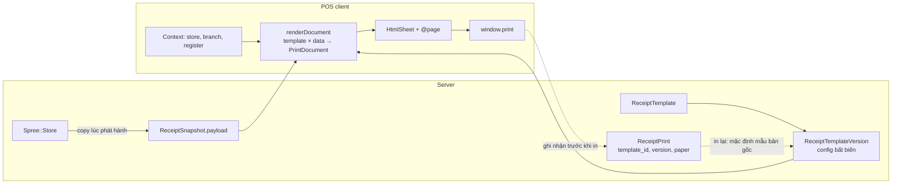

# POS: mẫu in hóa đơn tùy biến

## Overview

Người bán tự chỉnh mẫu in phiếu POS trong **Cài đặt POS → Mẫu in** (không thuộc Spree Admin). Mẫu dạng **ghép khối**: đầu phiếu và chân phiếu gồm các khối text/logo/QR sắp xếp được; phần thông tin, dòng hàng, tổng tiền và thanh toán là các section cố định thứ tự, chỉ bật/tắt trường, cột và đổi nhãn. Mẫu không bao giờ tính hay sửa số tiền.

Research và so sánh thị trường: [261108-1500-pos-receipt-template-research.md](../reports/261108-1500-pos-receipt-template-research.md).

## Quyết định đã chốt (08/11/2026)

| # | Quyết định |
|---|---|
| D1 | Mẫu thuộc **cửa hàng**. Chi nhánh và quầy không có mẫu riêng; thông tin của chúng chỉ đổ vào mẫu qua biến (`{branch.name}`, `{register.name}`…). |
| D2 | **In lại dùng đúng mẫu, phiên bản và khổ giấy của bản in gốc.** Thu ngân được chọn mẫu khác khi bản gốc in hỏng hoặc sai mẫu. Vì vậy mỗi lần lưu mẫu tạo một phiên bản bất biến. |
| D3 | HĐĐT khởi tạo từ máy tính tiền là **phase cuối, tách riêng, chưa làm** (chưa nhắm cửa hàng doanh thu ≥ 1 tỷ/năm). |
| D4 | **Không** có chế độ HTML/Liquid tự do, kể cả khổ A4. |
| D5 | Thông tin doanh nghiệp lấy từ **`Spree::Store`** (`name`, `address`, `contact_phone`, `customer_support_email`, `url`, `facebook`, `instagram`, logo). POS không tự quản lý hồ sơ doanh nghiệp. `Spree::Store` không có MST nên P1–P5 không in MST. |

## Nguyên tắc bất biến

1. Snapshot (`Spree::Pos::ReceiptSnapshot`) là dữ kiện; mẫu chỉ là trình bày. Mẫu không đọc dữ liệu ngoài payload và context.
2. Luôn in, không tắt được: nhãn "BẢN SAO", disclaimer "không phải hóa đơn điện tử", tiêu đề chứng từ, số chứng từ, tổng cộng, nhãn "TẠM TÍNH/CHƯA THANH TOÁN" của phiếu tạm tính.
3. Che tên/SĐT khách vẫn do server quyết định; mẫu không mở khóa được.
4. Biến chỉ theo whitelist, render thành text node (không HTML), có giới hạn độ dài.
5. Lỗi tải mẫu không bao giờ chặn bán hàng hay in: luôn có mẫu mặc định dựng sẵn trong client để dự phòng.
6. Một mô hình tài liệu, nhiều renderer: hôm nay HTML + `@page`, sau này ESC/POS.

## Phases

| Phase | Tên | Effort | Status |
|---|---|---|---|
| 1 | [Renderer hợp nhất và dữ liệu cửa hàng](./phase-01-renderer-hop-nhat-va-du-lieu-cua-hang.md) | 2 ngày | Completed |
| 2 | [Model và API mẫu in](./phase-02-model-va-api-mau-in.md) | 2,5 ngày | Completed |
| 3 | [Cài đặt POS → Mẫu in (editor)](./phase-03-cai-dat-mau-in-editor.md) | 3 ngày | Pending |
| 4 | [In theo mẫu ở quầy và in lại](./phase-04-in-theo-mau-va-in-lai.md) | 2 ngày | Pending |
| 5 | [Tùy biến nâng cao](./phase-05-tuy-bien-nang-cao.md) | 3,5 ngày | Pending |
| 6 | [Hóa đơn điện tử máy tính tiền](./phase-06-hoa-don-dien-tu-may-tinh-tien.md) | Chưa ước lượng | Deferred |

Thứ tự: 1 → 2 → 3 và 4 (3, 4 làm song song được sau 2) → 5. Phase 6 chỉ mở khi có quyết định kinh doanh và chọn nhà cung cấp HĐĐT.

## Luồng tổng thể

## Phạm vi loại chứng từ

`sale` (phiếu bán hàng), `prebill` (tạm tính), `payment_ticket` (phiếu thanh toán khổ nhiệt khi thu tiền), `return` (gồm `return_supplement`), `refund`, `shift_closure`. Chỉ `sale`, `return`, `return_supplement`, `refund`, `shift_closure` có snapshot và bản in được ghi nhận; `prebill` và `payment_ticket` không ghi nhận nên luôn dùng phiên bản hiện tại.

## Rủi ro chính

| Rủi ro | Giảm thiểu |
|---|---|
| Refactor renderer làm đổi phiếu đang chạy | Phase 1 dựng mẫu mặc định tái tạo **đúng** output hiện tại; giữ nguyên test hiện có và e2e `receipts-display`, `split-tender`. |
| Client renderer và validator server lệch schema | `config.schema = 1`; server là nguồn chân lý, client bỏ qua khối lạ; spec contract dùng chung fixture JSON. |
| Logo chưa tải xong lúc in | Chờ `img.decode()` (timeout ngắn) trước `window.print()`; lỗi thì in không logo. |
| Text dài vỡ khổ 58mm | Giới hạn ký tự, cảnh báo trong editor, CSS `overflow-wrap:anywhere`. |
| Snapshot cũ không có địa chỉ/SĐT | Khối rỗng tự ẩn; không backfill snapshot (bất biến). |

## Kiểm thử

- Client: `pnpm --dir apps/pos test`, `pnpm --dir apps/pos typecheck`, `pnpm --dir apps/pos lint`, `pnpm --dir apps/pos test:e2e`.
- Server: `pnpm spree rspec spec/requests/spree/pos/ spec/models/spree/pos/`.
- Thay đổi `server/` chỉ có hiệu lực khi project đã eject (`docker-compose.yml` mount `./server:/rails`).

## Câu hỏi còn mở (không chặn P1–P2)

1. Giới hạn số mẫu đang dùng cho mỗi loại chứng từ: plan đặt **5** (như KiotViet).
2. Khối QR thanh toán VietQR trên phiếu tạm tính phụ thuộc plan [VietQR](../261108-0934-vietqr-spree6-pos/plan.md); nếu chưa xong thì phase 5 chỉ làm QR URL và mã vạch số đơn.
