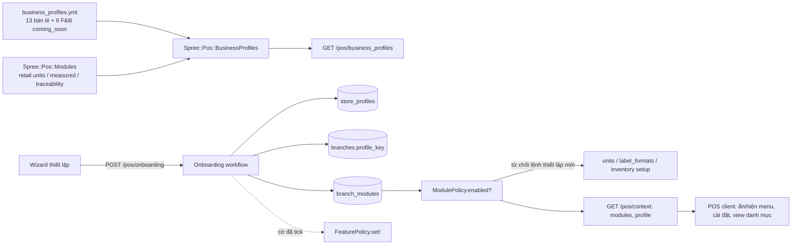

# POS: bán lẻ đa ngành (Giai đoạn 0)

## Overview

Khi thiết lập POS lần đầu, chủ shop chọn **ngành**: 13 ngành bán lẻ chọn được ngay, 6 ngành ăn uống – giải trí hiện nhãn "Sắp hỗ trợ". Ngành là **hồ sơ cấu hình sẵn theo chi nhánh**. Hồ sơ bật các module bán lẻ phù hợp, gợi ý mặc định của chi nhánh và cách hiển thị danh mục, gợi ý các chức năng rủi ro nên bật. Hồ sơ không khóa gì: đổi được về sau, và không bao giờ đổi cách bán một SKU đã cấu hình.

Kiến trúc và lý do: [261108-1800-pos-multi-industry-architecture.md](../reports/261108-1800-pos-multi-industry-architecture.md) (§3, §7, §8). Khảo sát thị trường: [261108-1700-pos-nganh-hang-thi-truong-research.md](../reports/261108-1700-pos-nganh-hang-thi-truong-research.md).

## Quyết định đã chốt

| # | Quyết định |
|---|---|
| D1 | Ngành gắn **theo chi nhánh** (`profile_key`). Store có một hồ sơ chính, là mặc định khi tạo chi nhánh mới. Không có code nào kiểm tra tên ngành; code chỉ kiểm tra module. |
| D2 | Phạm vi là **bán lẻ**. F&B chỉ có trong danh mục với trạng thái `coming_soon`; chọn được để ghi nhận nhu cầu, nhưng không tạo được chi nhánh F&B. F&B sau này là app, có plan riêng. |
| D3 | Danh mục hồ sơ, module, quyền và cờ do **server** trả về. Client không giữ danh sách cứng làm nguồn chân lý, để app sau này đọc cùng một hợp đồng API. |
| D4 | Module ở giai đoạn này là ba module bán lẻ đã có code: `retail.units` (quy đổi đơn vị), `retail.measured` (hàng cân, tem cân), `retail.traceability` (serial, lô, HSD). |
| D5 | **Module không bao giờ chặn việc bán.** Tắt module chỉ ẩn màn cấu hình ở chi nhánh và từ chối lệnh *thiết lập mới* (cấu hình SKU, mẫu tem, nhập tồn đầu kỳ; nhận thêm hàng cho SKU đã theo dõi vẫn mở, xem câu hỏi đã chốt 4). Bán, trả hàng và các guard theo dữ liệu SKU (`Tenders::Guard.tracked_guard!` ở prepare / confirm / allocate / complete) luôn chạy như hiện tại. |
| D6 | Hồ sơ **không tự bật** cờ rủi ro (`credit`, `returns`, `refunds`, …). Wizard chỉ gắn nhãn "Ngành này thường dùng" và để trống ô chọn. Quản lý tự tick; khi đó ghi qua `FeaturePolicy.set!` với lý do "Thiết lập theo ngành: …". Cách này giữ quyết định cũ: chức năng rủi ro mặc định tắt. |
| D7 | Đổi hồ sơ không ghi đè cấu hình đã chỉnh tay. Server trả về **diff**; người dùng chọn áp từng giá trị mặc định. |
| D8 | Chưa làm hook pipeline. Tách guard khỏi `Workspaces::Complete` không có lợi gì cho Giai đoạn 0, lại sinh rủi ro trên đường tiền. Hook runner sẽ làm ở module đầu tiên cần đến nó (dự kiến `warranty`). |

## Nguyên tắc bất biến

1. Chi nhánh đang chạy giữ nguyên hành vi: backfill gán `profile_key = 'khac'` và bật cả ba module.
2. Không đổi bảng hay luồng tiền, ca, tender, công nợ, trả hàng.
3. Mọi thay đổi hồ sơ / module có audit (`branch_profile.change`, `branch_module.change`, `store_profile.change`).
4. Hồ sơ ngành là dữ liệu có version trong code (`server/config/pos/business_profiles.yml`), được validate khi boot và trong spec. Merchant không sửa hồ sơ, chỉ chọn.
5. Client gặp module hoặc hồ sơ không biết thì bỏ qua phần UI tương ứng, không lỗi. Server vẫn là bên quyết định.

## Phases

| Phase | Tên | Effort | Status |
|---|---|---|---|
| 1 | [Registry module, danh mục hồ sơ, dữ liệu](./phase-01-registry-va-du-lieu-ho-so-nganh.md) | 2 ngày | Completed |
| 2 | [Áp hồ sơ, bật/tắt module, chặn lệnh thiết lập](./phase-02-ap-ho-so-va-module-chi-nhanh.md) | 2 ngày | Completed |
| 3 | [Client: context, ẩn hiện theo module, mặc định hiển thị](./phase-03-client-module-va-hien-thi.md) | 2 ngày | Completed |
| 4 | [Wizard thiết lập và trang Mô hình kinh doanh](./phase-04-wizard-thiet-lap-va-mo-hinh-kinh-doanh.md) | 2,5 ngày | Completed |
| 5 | [Kiểm thử hồi quy, tài liệu, rollout](./phase-05-kiem-thu-tai-lieu-rollout.md) | 1,5 ngày | Pending |

Thứ tự: 1 → 2 → (3 và 4 làm song song được sau 2; 4 dùng hook client của 3) → 5.

## Luồng tổng thể

## Rủi ro chính

| Rủi ro | Giảm thiểu |
|---|---|
| Backfill làm mất chức năng của chi nhánh đang chạy | `khac` bật cả ba module. Spec migration trên dữ liệu có SKU cân, tracked, quy đổi. Chạy lại toàn bộ e2e. |
| Tắt module khiến không bán được SKU đã cấu hình | D5: chỉ chặn lệnh thiết lập. Có spec khẳng định bán / trả / nhận tiền của SKU tracked vẫn chạy khi module tắt. |
| SKU là cấu hình cấp store, còn module bật theo chi nhánh | Lệnh cấu hình SKU (`PUT /pos/units/variant`) dùng điều kiện "module bật ở **ít nhất một** chi nhánh active". Lệnh có chi nhánh (mẫu tem, nhập tồn) dùng module của chính chi nhánh đó. |
| Onboarding retry tạo chi nhánh hai lần | Lệnh có idempotency key; `(store_id, code)` của chi nhánh đã unique. |
| Hai đường tạo chi nhánh lệch nhau | Wizard và `POST /branches` dùng chung một workflow `Branches::Create` (phase 2). |

## Kiểm thử

- Server: `pnpm spree rspec spec/requests/spree/pos/ spec/models/spree/pos/ spec/services/spree/pos/`.
- Client: `pnpm --dir apps/pos lint`, `typecheck`, `test`, `test:e2e`.
- Thay đổi trong `server/` chỉ có hiệu lực khi project đã eject (`docker-compose.yml` mount `./server:/rails`).

## Ngoài phạm vi

- Module bán lẻ mới: `wholesale`, `variant_grid`, `warranty`, `deposits` / `preorder_delivery`, `prescription`. Mỗi module có plan riêng, theo thứ tự ở báo cáo kiến trúc §9.1.
- Hook pipeline, registry SaleLine kind, `Workspace.service_mode`, `resources`: để cho plan module / F&B.
- Đơn vị mét, m², m³ (dimension `length` / `area`): check constraint hiện chỉ cho `mass|volume|count`. VLXD trong đợt này dùng đơn vị đếm (bao, tấm, cây, xe). Câu hỏi mở 2.

## Câu hỏi đã chốt (08/11/2026)

1. Bảng giá trị mặc định của 19 hồ sơ ở phase 1: **duyệt nguyên bảng**.
2. Dimension `length` / `area` cho VLXD: **chưa làm**. Đợt này VLXD dùng đơn vị đếm; độ dài và diện tích làm plan riêng.
3. Wizard: ô cờ rủi ro **để trống**; ô "cấp cho tôi toàn quyền" **tick sẵn, bỏ được**.
4. Chi nhánh tắt `retail.traceability` **vẫn nhập thêm hàng được cho SKU đã theo dõi**. Chỉ chặn tồn đầu kỳ và việc chuyển SKU mới sang theo dõi. Lối vào Nhập hàng vẫn hiện khi store còn SKU đang theo dõi.
5. Mỗi phase commit riêng, chỉ stage file của phase đó; không đụng các thay đổi mẫu in đang dở trên `v2`.
