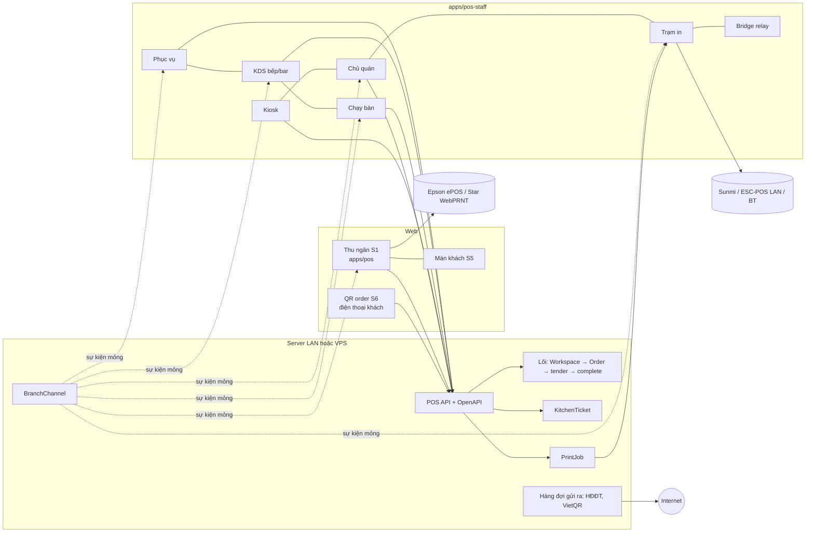

# POS F&B và giải trí

## Overview

Plan này làm toàn bộ tính năng trong [báo cáo research F&B](../reports/261109-1748-pos-fnb-giai-tri-research.md) cho 6 ngành đang ở trạng thái `coming_soon`: quán ăn, cafe / trà sữa, karaoke / bida, bar / pub / club, căng tin / trạm dừng, nhà hàng. Đủ 8 bề mặt S1–S8, gồm app phục vụ gọi món và màn bếp.

Plan kế thừa kiến trúc lõi + module + hồ sơ ngành ([kiến trúc đa ngành](../reports/261108-1800-pos-multi-industry-architecture.md)) và các phần plan [bán lẻ đa ngành](../261108-1830-pos-ban-le-da-nganh/plan.md) đã làm xong: registry module, hồ sơ, `branch_modules`, wizard.

## Quyết định đã chốt (09/11/2026)

| # | Quyết định |
|---|---|
| D1 | Thứ tự mở ngành giữ như research. F1: cafe / trà sữa, quán ăn trả trước, căng tin bán nhanh. F2: quán ăn có bàn, nhà hàng cơ bản, bar dạng bàn. F3: karaoke / bida. F4: các tính năng nâng cao theo ngành. F5: kênh khách và offline. |
| D2 | **Thu ngân S1 là web `apps/pos`.** Màn khách S5 cũng là web, mở rộng `customer-display` đang có. QR order S6 là web, chạy trên điện thoại khách và không cần cài. |
| D3 | **Phục vụ S2, bếp/bar S3, chạy bàn S4, kiosk S7, chủ quán S8 và trạm in nằm chung một app Flutter nhiều chế độ** (`apps/pos-staff`), làm cho cả Android và iOS. Chế độ chọn khi ghép thiết bị, không phải app riêng cho từng ngành. |
| D4 | **In:** server có hàng đợi in. App Flutter ở chế độ **trạm in** nhận job và in ra máy in Sunmi tích hợp, ESC/POS qua LAN (TCP 9100) và ESC/POS qua Bluetooth. Thu ngân web in thẳng ra Epson ePOS-Print / Star WebPRNT bằng adapter trình duyệt, còn hộp thoại trình duyệt giữ làm đường dự phòng. Không làm SDP / CloudPRNT. |
| D5 | **Triển khai:** mỗi khách chạy ParkViet trên **server LAN tại quán** (mini PC chạy stack Docker) hoặc **VPS riêng**. App Flutter và web luôn có **cấu hình địa chỉ server**, và QR ghép thiết bị chứa sẵn địa chỉ đó. Server LAN giúp quán bán tiếp khi mất internet, vì app và server cùng mạng nội bộ. Chỉ những việc cần internet mới đi qua hàng đợi gửi ra ngoài: webhook VietQR, hóa đơn điện tử, đơn Grab / Shopee. |
| D6 | **Mạng:** bản đầu cần kết nối tới server (LAN hoặc VPS). Hàng đợi offline phía client cho thu ngân trả trước làm ở F5 (phase 27). Không viết lại lõi để chạy trên thiết bị như iPOS: luật nghiệp vụ chỉ chạy ở server, và server LAN đã giải quyết bài toán mất internet. |
| D7 | Các bề mặt S2, S3, S4, S8 **không thu tiền**. Tiền chỉ đi qua lõi: Workspace → đúng một draft Order → tender → ReceivedFunds → complete. Kiosk S7 là ngoại lệ có kiểm soát: chỉ VietQR khớp webhook hoặc "trả tại quầy" (phase 23). |
| D8 | `business_date` và giờ cắt ngày kinh doanh là **lõi**, không phải module, vì ca, số gọi và báo cáo đều dùng (research §5.2 đã gợi ý). Thuế suất theo món dùng `TaxCategory` của Spree và đổi được bằng cấu hình, không phải sửa code, khi mức 8% hết hạn ngày 01/01/2027. |
| D9 | Code chỉ kiểm tra module, không kiểm tra tên ngành. Module F&B **không tự bật cờ rủi ro**: giữ D5 / D6 của plan bán lẻ đa ngành. |
| D10 | `fnb.recipes` (trừ nguyên liệu) chuyển lên **F1**. Research xếp nó ở F2, nhưng chính research đánh dấu trừ nguyên liệu là **[bắt buộc]** với cafe. |

## Nguyên tắc bất biến

1. Chi nhánh bán lẻ đang chạy giữ nguyên hành vi. Chi nhánh không bật module F&B thì không thấy và không bị ảnh hưởng bởi phần nào của plan này.
2. Mọi lệnh ghi đi qua `CommandExecutor` và có idempotency key (`CommandReceipt`). Ticket bếp, job in, phiên tính giờ và hóa đơn điện tử đều idempotent theo key.
3. Nội dung phiếu là snapshot dựng ở server; adapter chỉ lo việc in. Giờ chơi, giờ ticket và ngày kinh doanh lấy theo `Workspace.database_now`. Client chỉ hiển thị.
4. Hủy món đã báo bếp, in lại hoặc hủy tạm tính và sửa giờ chơi đều đi qua `Approval` và ghi `AuditEntry`.
5. Mỗi phase thêm hoặc đổi endpoint đều cập nhật hợp đồng OpenAPI `server/openapi/pos-staff.yaml`, vì app Flutter sinh client từ file này (phase 5).
6. Mỗi phase commit riêng, chỉ stage file của phase đó.

## Quy ước tên dùng chung giữa các phase

| Khái niệm | Tên |
|---|---|
| Hình thức phục vụ | `Workspace.service_mode`: `counter`, `dine_in`, `takeaway`, `delivery`, `tab`, `timed` |
| Kiểu dòng | `SaleLine.kind` mở rộng qua registry `Spree::Pos::SaleLineKinds`. Đã có: `ordinary`, `measured`, `tracked`. Thêm: `menu`, `timed`, `cover` |
| Thiết bị | `Spree::Pos::Device` (`spree_pos_devices`), mode: `waiter`, `kds`, `expo`, `kiosk`, `print_station`, `owner`, `bridge` |
| Realtime | `Spree::Pos::BranchChannel` + `Spree::Pos::Realtime.publish(branch, event, payload)` sau commit. Sự kiện: `workspace.updated`, `kitchen_ticket.updated`, `menu.sold_out`, `payment.requested`, `print_job.created`, `resource.updated`, `approval.requested`; các phase sau thêm `guest_order.created`, `guest_request.created` (22), `owner_alert.created` (24), `relay.command` (26) |
| In | `Spree::Pos::Printer`, `Spree::Pos::PrintJob`, tài liệu trung lập `PrintDocument` v1. Loại phiếu: `receipt`, `prebill`, `kitchen_ticket`, `void_ticket`, `cup_label`, `checklist`, `table_qr`, `test`. `Printer.command_language`: `escpos` hoặc `tspl` |
| Bếp | `KitchenStation` (`prep`, `bar`, `expo`), `StationRoute`, `KitchenTicket` (bất biến), `KitchenTicketItem` |
| Bàn / phòng | `Area`, `Resource` (`table`, `room`, `billiard`, `vip`) |
| Tính giờ | `RatePlan`, `RateRule`, `SpecialDay`, `TimedSession`, `TimedSegment` |
| API cho thiết bị | `api/v3/pos_device/*` (header `Authorization: Device <token>`, nhân viên đăng nhập PIN thêm `X-Pos-Staff-Session`). Khách: `api/v3/pos_guest/*` |
| Hợp đồng | `server/openapi/pos-staff.yaml` (nhân viên, thiết bị), `server/openapi/pos-guest.yaml` (QR order) |
| Ai được sửa đơn | `AccessPolicy#can_edit_workspace?` (phase 13). Lệnh ghi đơn từ phục vụ, kiosk, QR order đều qua helper này, không kiểm `shift.owner` trực tiếp |
| Ngày kinh doanh | `Branch.business_day_cutoff`, `business_date` trên Workspace và Shift, service `Spree::Pos::BusinessDay` |
| Nguồn đơn mới | `Workspace::ORDER_SOURCES` thêm `kiosk` (23), `grabfood`, `shopeefood` (25) |
| Module | Đã có tên: `fnb.menu`, `fnb.kitchen`, `fnb.order_number`, `fnb.recipes`, `resources`, `fnb.tables`, `fnb.postpay`, `fnb.service_charge`, `timed_billing`. Thêm: `fnb.cup_label` (10), `fnb.reservations` (18), `fnb.bottle_keep`, `fnb.pour_tracking` (19), `fnb.meal_accounts` (20), `fnb.qr_order` (22), `fnb.kiosk` (23), `fnb.delivery_platforms` (25), `resources.iot_relay` (26), `fnb.vehicle_commission` (28) |
| Ví / thẻ nạp | `Spree::Pos::StoredValue` (phase 20), phase 21 dùng lại cho thẻ nạp tiền / giờ |
| App Flutter | `apps/pos-staff`, package `parkviet_staff`, client sinh ra ở `apps/pos-staff/packages/pos_api` |

Tên bảng theo mẫu `spree_pos_<số nhiều>`, có prefixed ID (`has_prefix_id`). Mỗi phase ghi cột cụ thể của mình.

## Phases

| # | Đợt | Phase | Effort | Phụ thuộc |
|---|---|---|---|---|
| 1 | F0 | [ADR và nền đơn hàng F&B](./phase-01-adr-nen-don-hang-fnb.md) | 6 ngày | – |
| 2 | F0 | [Thiết bị, ghép mã, PIN nhân viên](./phase-02-thiet-bi-ghep-ma-pin.md) | 5 ngày | – |
| 3 | F0 | [Realtime theo chi nhánh](./phase-03-realtime-theo-chi-nhanh.md) | 4 ngày | 2 |
| 4 | F0 | [Hàng đợi in và máy in](./phase-04-hang-doi-in-may-in.md) | 6 ngày | 2, 3 |
| 5 | F0 | [Khung app Flutter, trạm in](./phase-05-app-flutter-khung.md) | 9 ngày | 2, 3, 4 |
| 6 | F0 | [Triển khai server LAN / VPS](./phase-06-trien-khai-lan-vps.md) | 4 ngày | 2, 5 |
| 7 | F1 | [Hóa đơn điện tử](./phase-07-hoa-don-dien-tu.md) | 7 ngày | 1 |
| 8 | F1 | [Thực đơn, modifier, combo](./phase-08-thuc-don-modifier-combo.md) | 8 ngày | 1 |
| 9 | F1 | [Bếp: trạm, ticket, KDS](./phase-09-bep-kds-phieu-bep.md) | 9 ngày | 3, 4, 5, 8 |
| 10 | F1 | [Số gọi, tem ly, màn khách gọi số](./phase-10-so-goi-tem-ly-man-khach.md) | 4 ngày | 1, 4, 8, 9 |
| 11 | F1 | [Công thức và trừ kho](./phase-11-cong-thuc-tru-kho.md) | 5 ngày | 8 |
| 12 | F1 | [Mở ngành đợt 1](./phase-12-mo-nganh-dot-1.md) | 3 ngày | 6, 7, 8, 9, 10, 11 |
| 13 | F2 | [Bàn, khu vực, trả sau, phí phục vụ](./phase-13-ban-khu-vuc-tra-sau.md) | 8 ngày | 12 |
| 14 | F2 | [Nhiều máy cùng sửa đơn, báo bếp theo phần chênh lệch](./phase-14-nhieu-may-cung-sua-don.md) | 7 ngày | 9, 13 |
| 15 | F2 | [App phục vụ, KDS đầy đủ](./phase-15-app-phuc-vu-kds-day-du.md) | 9 ngày | 5, 13, 14 |
| 16 | F2 | [Mở ngành đợt 2](./phase-16-mo-nganh-dot-2.md) | 2 ngày | 15 |
| 17 | F3 | [Tính giờ karaoke / bida](./phase-17-tinh-gio-karaoke-bida.md) | 9 ngày | 13, 15 |
| 18 | F4 | [Nhà hàng nâng cao: expo, course, ghế, buffet, đặt bàn + cọc](./phase-18-nha-hang-nang-cao.md) | 9 ngày | 16 |
| 19 | F4 | [Bar, pub & club](./phase-19-bar-pub-club.md) | 7 ngày | 16 |
| 20 | F4 | [Căng tin: tài khoản suất ăn, ví, công nợ công ty](./phase-20-can-tin-the-suat-an.md) | 7 ngày | 12 |
| 21 | F4 | [Karaoke / bida nâng cao](./phase-21-karaoke-bida-nang-cao.md) | 4 ngày | 17, 20 |
| 22 | F5 | [QR order tại bàn](./phase-22-qr-order-tai-ban.md) | 7 ngày | 16 |
| 23 | F5 | [Kiosk tự order](./phase-23-kiosk-tu-order.md) | 5 ngày | 5, 12 |
| 24 | F5 | [App chủ quán](./phase-24-app-chu-quan.md) | 5 ngày | 3, 5 |
| 25 | F5 | [Đơn từ nền tảng giao hàng (nhập tay)](./phase-25-don-nen-tang-giao-hang.md) | 3 ngày | 9 |
| 26 | F5 | [Relay đèn bida](./phase-26-relay-den-bida.md) | 4 ngày | 5, 17 |
| 27 | F5 | [Hàng đợi offline cho thu ngân](./phase-27-offline-thu-ngan.md) | 6 ngày | 12 |
| 28 | F4 | [Hoa hồng tài xế / phụ xe ở trạm dừng](./phase-28-hoa-hong-tai-xe-tram-dung.md) | 4 ngày | 12, 16 |

Thứ tự:
- Phase 1, 2 và 7 làm song song được. 3 → 4 → 5 → 6 là chuỗi hạ tầng.
- Ở F1, phase 8 mở đường cho 9, 10 và 11; phase 12 chốt đợt.
- Từ F4, các phase chỉ phụ thuộc vào đợt trước nên làm song song được nếu có người. Phase 28 thuộc F4 nhưng đánh số cuối vì được thêm sau.

## Luồng tổng thể

## Rủi ro chính

| Rủi ro | Giảm thiểu |
|---|---|
| Nới lease cho nhiều phục vụ cùng sửa một bàn phá bất biến chống ghi đè | Phase 14 chỉ cho **thêm dòng** mà không cần lease, vẫn kiểm `revision` theo dòng. Sửa hoặc xóa dòng đã báo bếp vẫn cần lease hoặc `Approval`. Chạy lại `workspace_race_spec` và toàn bộ e2e bán hàng. |
| Hai codebase UI (web + Flutter) lệch hợp đồng API | Hợp đồng OpenAPI duy nhất. Request spec kiểm response theo schema. Client Dart sinh từ file đó, và CI fail khi client sinh ra lệch với file đã commit. |
| Server LAN không nhận được webhook VietQR hay gọi được hóa đơn điện tử khi mất internet | Phase 6: tunnel ra ngoài (cloudflared) hoặc đối soát bằng polling; xác nhận tay vẫn còn. Hóa đơn điện tử đi qua hàng đợi chạy lại (phase 7). |
| Solid Cable chưa đo dưới tải | Phase 3 có bài đo độ trễ (mục tiêu KDS ≤ 2 giây) và giữ poll làm dự phòng. |
| Pháp lý mới đọc qua nguồn thứ cấp (NĐ 254/2026, TT 91/2026) | Phase 7 có bước đọc nguyên văn trước khi chốt trường hóa đơn. Thuế suất là cấu hình. |
| Phạm vi rất lớn (28 phase) | Mỗi đợt kết thúc bằng phase "mở ngành", có thể phát hành độc lập. Từ F4 trở đi có thể dừng hoặc đổi thứ tự mà không ảnh hưởng đợt đã mở. |

## Kiểm thử

- Server: `pnpm spree rspec spec/requests/spree/pos/ spec/models/spree/pos/ spec/services/spree/pos/ spec/workflows/spree/pos/ spec/integration/spree/pos/`.
- Web: `pnpm --dir apps/pos lint`, `typecheck`, `test`, `test:e2e`.
- Flutter: `flutter analyze`, `flutter test`, `flutter test integration_test` trong `apps/pos-staff`, build `apk` và `ios --no-codesign` trên CI.
- Thay đổi trong `server/` chỉ có hiệu lực khi project đã eject (`docker-compose.yml` mount `./server:/rails`).

## Ngoài phạm vi

- Server Direct Print (Epson) và CloudPRNT (Star).
- Chạy lõi nghiệp vụ trên thiết bị (mô hình máy POS làm server như iPOS). Server LAN thay cho mô hình này.
- Thu tiền trên app phục vụ (thanh toán tại bàn bằng máy thẻ). Thu tại bàn bằng VietQR qua màn của khách là việc làm sau, không nằm trong plan này.

## Câu hỏi đã chốt (09/11/2026)

1. **Hóa đơn điện tử:** mỗi khách chọn nhà cung cấp của mình. Phase 7 làm adapter VNPT trước vì khách thường dùng VNPT; các nhà cung cấp khác thêm adapter theo cùng interface.
2. **Thẻ căng tin:** chưa làm, để phát triển sau. Phase 20 nhận diện người ăn bằng mã nhân viên và để sẵn điểm nối cho thẻ.
3. **Hoa hồng tài xế / phụ xe ở trạm dừng:** tính theo xe và theo khách. Làm ở phase 28 mới.
4. **Grab / ShopeeFood:** chưa có hợp đồng, và nối API ShopeeFood tốn khoảng 500 triệu. Phase 25 chỉ làm nhập đơn tay; nối API để sau.
5. **Gửi rượu và tiếp viên:** chỉ ghi sổ, không đụng tiền, không vào bill (phase 19 và 21).

Không còn câu hỏi mở.
