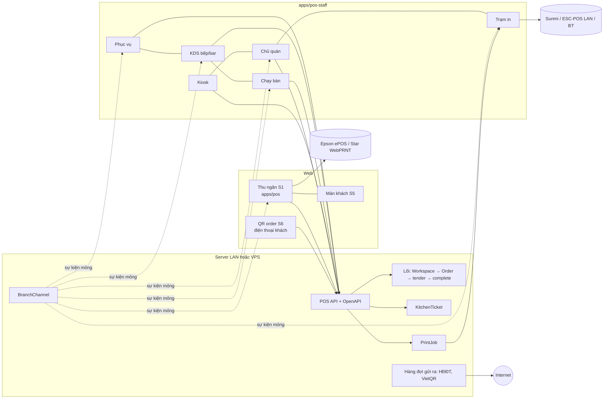

# POS F&B và giải trí

## Overview

Plan này làm toàn bộ tính năng trong [báo cáo research F&B](../reports/261109-1748-pos-fnb-giai-tri-research.md) cho 6 ngành đang ở trạng thái `coming_soon`: quán ăn, cafe / trà sữa, karaoke / bida, bar / pub / club, căng tin / trạm dừng, nhà hàng. Đủ 8 bề mặt S1–S8, gồm app phục vụ gọi món và màn bếp.

Plan kế thừa kiến trúc lõi + module + hồ sơ ngành ([kiến trúc đa ngành](../reports/261108-1800-pos-multi-industry-architecture.md)) và các phần plan [bán lẻ đa ngành](../261108-1830-pos-ban-le-da-nganh/plan.md) đã làm xong: registry module, hồ sơ, `branch_modules`, wizard.

## Quyết định đã chốt (09/11/2026)

| # | Quyết định |
|---|---|
| D1 | Thứ tự mở ngành giữ như research. F1: cafe / trà sữa, quán ăn trả trước, căng tin bán nhanh. F2: quán ăn có bàn, nhà hàng cơ bản, bar dạng bàn. F3: karaoke / bida. F4: các tính năng nâng cao theo ngành. F5: kênh khách và offline. |
| D2 | **Thu ngân S1 là web `apps/pos`.** Màn khách S5 cũng là web, mở rộng `customer-display` đang có. QR order S6 là web, chạy trên điện thoại khách và không cần cài. |
| D3 | **Phục vụ S2, bếp/bar S3, chạy bàn S4, kiosk S7, chủ quán S8 và trạm in nằm chung một app Flutter nhiều chế độ** (`apps/pos-staff`), làm cho cả Android và iOS. Chế độ chọn khi ghép thiết bị, không phải app riêng cho từng ngành. |
| D4 | **In:** server có hàng đợi in. App Flutter ở chế độ **trạm in** nhận job và in ra máy in Sunmi tích hợp, ESC/POS qua LAN (TCP 9100) và ESC/POS qua Bluetooth. Thu ngân web in thẳng ra Epson ePOS-Print / Star WebPRNT bằng adapter trình duyệt, còn hộp thoại trình duyệt giữ làm đường dự phòng. Không làm SDP / CloudPRNT. |
| D5 | **Triển khai:** mỗi khách chạy ParkViet trên **server LAN tại quán** (mini PC chạy stack Docker) hoặc **VPS riêng**. App Flutter và web luôn có **cấu hình địa chỉ server**, và QR ghép thiết bị chứa sẵn địa chỉ đó. Server LAN giúp quán bán tiếp khi mất internet, vì app và server cùng mạng nội bộ. Chỉ những việc cần internet mới đi qua hàng đợi gửi ra ngoài: webhook VietQR, hóa đơn điện tử, đơn Grab / Shopee. |
| D6 | **Mạng:** bản đầu cần kết nối tới server (LAN hoặc VPS). Hàng đợi offline phía client cho thu ngân trả trước làm ở F5 (phần 12D). Không viết lại lõi để chạy trên thiết bị như iPOS: luật nghiệp vụ chỉ chạy ở server, và server LAN đã giải quyết bài toán mất internet. |
| D7 | Các bề mặt S2, S3, S4, S8 **không thu tiền**. Tiền chỉ đi qua lõi: Workspace → đúng một draft Order → tender → ReceivedFunds → complete. Kiosk S7 là ngoại lệ có kiểm soát: chỉ VietQR khớp webhook hoặc "trả tại quầy" (phần 12B). |
| D8 | `business_date` và giờ cắt ngày kinh doanh là **lõi**, không phải module, vì ca, số gọi và báo cáo đều dùng (research §5.2 đã gợi ý). Thuế suất theo món dùng `TaxCategory` của Spree và đổi được bằng cấu hình, không phải sửa code, khi mức 8% hết hạn ngày 01/01/2027. |
| D9 | Code chỉ kiểm tra module, không kiểm tra tên ngành. Module F&B **không tự bật cờ rủi ro**: giữ D5 / D6 của plan bán lẻ đa ngành. |
| D10 | `fnb.recipes` (trừ nguyên liệu) chuyển lên **F1**. Research xếp nó ở F2, nhưng chính research đánh dấu trừ nguyên liệu là **[bắt buộc]** với cafe. |

## Nguyên tắc bất biến

1. Chi nhánh bán lẻ đang chạy giữ nguyên hành vi. Chi nhánh không bật module F&B thì không thấy và không bị ảnh hưởng bởi phần nào của plan này.
2. Mọi lệnh ghi đi qua `CommandExecutor` và có idempotency key (`CommandReceipt`). Ticket bếp, job in, phiên tính giờ và hóa đơn điện tử đều idempotent theo key.
3. Nội dung phiếu là snapshot dựng ở server; adapter chỉ lo việc in. Giờ chơi, giờ ticket và ngày kinh doanh lấy theo `Workspace.database_now`. Client chỉ hiển thị.
4. Hủy món đã báo bếp, in lại hoặc hủy tạm tính và sửa giờ chơi đều đi qua `Approval` và ghi `AuditEntry`.
5. Mỗi phase thêm hoặc đổi endpoint đều cập nhật hợp đồng OpenAPI `server/openapi/pos-staff.yaml`, vì app Flutter sinh client từ file này (phần 5A).
6. Mỗi plan commit riêng, chỉ stage file của plan đó.

## Quy ước tên dùng chung giữa các phase

| Khái niệm | Tên |
|---|---|
| Hình thức phục vụ | `Workspace.service_mode`: `counter`, `dine_in`, `takeaway`, `delivery`, `tab`, `timed` |
| Kiểu dòng | `SaleLine.kind` mở rộng qua registry `Spree::Pos::SaleLineKinds`. Đã có: `ordinary`, `measured`, `tracked`. Thêm: `menu`, `timed`, `cover` |
| Thiết bị | `Spree::Pos::Device` (`spree_pos_devices`), mode: `waiter`, `kds`, `expo`, `kiosk`, `print_station`, `owner` |
| Realtime | `Spree::Pos::BranchChannel` + `Spree::Pos::Realtime.publish(branch, event, payload)` sau commit. Sự kiện: `workspace.updated`, `kitchen_ticket.updated`, `menu.sold_out`, `payment.requested`, `print_job.created`, `resource.updated`, `approval.requested`; các phase sau thêm `guest_order.created`, `guest_request.created` (12A), `owner_alert.created` (12C) |
| In | `Spree::Pos::Printer`, `Spree::Pos::PrintJob`, tài liệu trung lập `PrintDocument` v1. Loại phiếu: `receipt`, `prebill`, `kitchen_ticket`, `void_ticket`, `cup_label`, `checklist`, `table_qr`, `test`. `Printer.command_language`: `escpos` hoặc `tspl` |
| Bếp | `KitchenStation` (`prep`, `bar`, `expo`), `StationRoute`, `KitchenTicket` (bất biến), `KitchenTicketItem` |
| Bàn / phòng | `Area`, `Resource` (`table`, `room`, `billiard`, `vip`) |
| Tính giờ | `RatePlan`, `RateRule`, `SpecialDay`, `TimedSession`, `TimedSegment` |
| API cho thiết bị | `api/v3/pos_device/*` (header `Authorization: Device <token>`, nhân viên đăng nhập PIN thêm `X-Pos-Staff-Session`). Khách: `api/v3/pos_guest/*` |
| Hợp đồng | `server/openapi/pos-staff.yaml` (nhân viên, thiết bị), `server/openapi/pos-guest.yaml` (QR order) |
| Ai được sửa đơn | `AccessPolicy#can_edit_workspace?` (phần 8A). Lệnh ghi đơn từ phục vụ, kiosk, QR order đều qua helper này, không kiểm `shift.owner` trực tiếp |
| Ngày kinh doanh | `Branch.business_day_cutoff`, `business_date` trên Workspace và Shift, service `Spree::Pos::BusinessDay` |
| Nguồn đơn mới | `Workspace::ORDER_SOURCES` thêm `kiosk` (12B), `grabfood`, `shopeefood` (7C) |
| Module | Đã có tên: `fnb.menu`, `fnb.kitchen`, `fnb.order_number`, `fnb.recipes`, `resources`, `fnb.tables`, `fnb.postpay`, `fnb.service_charge`, `timed_billing`. Thêm: `fnb.cup_label` (7B), `fnb.reservations` (9A), `fnb.bottle_keep`, `fnb.pour_tracking` (9B), `fnb.meal_accounts` (10A), `fnb.qr_order` (12A), `fnb.kiosk` (12B), `fnb.delivery_platforms` (7C), `fnb.vehicle_commission` (10B) |
| Ví / thẻ nạp | `Spree::Pos::StoredValue` (phần 10A), phần 11B dùng lại cho thẻ nạp tiền / giờ |
| App Flutter | `apps/pos-staff`, package `parkviet_staff`, client sinh ra ở `apps/pos-staff/packages/pos_api` |

Tên bảng theo mẫu `spree_pos_<số nhiều>`, có prefixed ID (`has_prefix_id`). Mỗi phase ghi cột cụ thể của mình.

## Phases

Ngày 11/11/2026, các phase chưa làm được gộp theo module: 24 phase cũ (5–28) thành 8 plan (5–12). Nội dung từng phase cũ giữ nguyên thành một phần trong plan mới, ký hiệu số plan kèm chữ cái, ví dụ phần 8B.

| # | Đợt | Plan | Gồm | Effort | Phụ thuộc | Trạng thái |
|---|---|---|---|---|---|---|
| 1 | F0 | [ADR và nền đơn hàng F&B](./phase-01-adr-nen-don-hang-fnb.md) | | 6 ngày | – | đang làm |
| 2 | F0 | [Thiết bị, ghép mã, PIN nhân viên](./phase-02-thiet-bi-ghep-ma-pin.md) | | 5 ngày | – | đang làm |
| 3 | F0 | [Realtime theo chi nhánh](./phase-03-realtime-theo-chi-nhanh.md) | | 4 ngày | 2 | xong |
| 4 | F0 | [Hàng đợi in và máy in](./phase-04-hang-doi-in-may-in.md) | | 6 ngày | 2, 3 | đang làm |
| 5 | F0 | [App Flutter và triển khai server](./phase-05-app-flutter-trien-khai.md) | 5A khung app, trạm in; 5B server LAN / VPS | 13 ngày | 2, 3, 4 | đang làm |
| 6 | F1 | [Thực đơn, công thức, hóa đơn điện tử](./phase-06-thuc-don-cong-thuc-hoa-don.md) | 6A thực đơn, modifier, combo; 6B công thức, trừ kho; 6C hóa đơn điện tử | 20 ngày | 1 | đang làm |
| 7 | F1 | [Bếp, quầy trả trước, mở đợt 1](./phase-07-bep-quay-mo-dot-1.md) | 7A bếp, KDS; 7B số gọi, tem ly, màn khách; 7C đơn nền tảng nhập tay; 7D mở ngành đợt 1 | 19 ngày | 1, 3, 4, 5, 6 | đang làm |
| 8 | F2 | [Bàn, phục vụ, mở đợt 2](./phase-08-ban-phuc-vu-mo-dot-2.md) | 8A bàn, trả sau; 8B nhiều máy cùng sửa đơn; 8C app phục vụ, KDS đầy đủ; 8D mở ngành đợt 2 | 26 ngày | 5, 7 | đang làm |
| 9 | F4 | [Nhà hàng nâng cao, bar](./phase-09-nha-hang-bar.md) | 9A nhà hàng nâng cao; 9B bar, pub, club | 16 ngày | 8 | đang làm |
| 10 | F4 | [Căng tin và trạm dừng](./phase-10-can-tin-tram-dung.md) | 10A tài khoản suất ăn, ví; 10B hoa hồng tài xế | 11 ngày | 8 | đang làm |
| 11 | F3–F5 | [Tính giờ, karaoke, bida](./phase-11-tinh-gio-giai-tri.md) | 11A tính giờ; 11B karaoke / bida nâng cao | 13 ngày | 5, 8, 10 | đang làm |
| 12 | F5 | [Kênh khách, chủ quán, offline](./phase-12-kenh-khach-chu-quan-offline.md) | 12A QR order; 12B kiosk; 12C app chủ quán; 12D offline thu ngân | 23 ngày | 3, 5, 8 | đang làm |

Thứ tự:
- Plan 5 và plan 6 không phụ thuộc nhau; plan 7 cần cả hai. Plan 8 làm sau plan 7.
- Sau plan 8, plan 9, 10 và 12 không phụ thuộc nhau. Plan 11 cần plan 10 vì phần 11B dùng `StoredValue` của phần 10A.

## Cách chạy

- Mỗi plan do một subagent làm, theo thứ tự các phần. Trong lúc làm chỉ chạy test hẹp của phần đang làm.
- Review toàn bộ diff và full suite chạy một lần khi xong cả plan, sau đó commit code và commit kết quả.
- Khi chạy song song, mỗi plan cần worktree riêng, nhưng rspec vẫn chỉ chạy một phiên một lúc trên database test và các cổng Playwright vẫn dùng chung.
- Tiêu chí cần phần cứng thật hoặc quán thử được ghi là còn mở và không chặn plan sau, như đã làm ở phase 4.

## Luồng tổng thể

## Rủi ro chính

| Rủi ro | Giảm thiểu |
|---|---|
| Nới lease cho nhiều phục vụ cùng sửa một bàn phá bất biến chống ghi đè | Phần 8B chỉ cho **thêm dòng** mà không cần lease, vẫn kiểm `revision` theo dòng. Sửa hoặc xóa dòng đã báo bếp vẫn cần lease hoặc `Approval`. Chạy lại `workspace_race_spec` và toàn bộ e2e bán hàng. |
| Hai codebase UI (web + Flutter) lệch hợp đồng API | Hợp đồng OpenAPI duy nhất. Request spec kiểm response theo schema. Client Dart sinh từ file đó, và CI fail khi client sinh ra lệch với file đã commit. |
| Server LAN không nhận được webhook VietQR hay gọi được hóa đơn điện tử khi mất internet | Phần 5B: tunnel ra ngoài (cloudflared) hoặc đối soát bằng polling; xác nhận tay vẫn còn. Hóa đơn điện tử đi qua hàng đợi chạy lại (phần 6C). |
| Solid Cable chưa đo dưới tải | Phase 3 có bài đo độ trễ (mục tiêu KDS ≤ 2 giây) và giữ poll làm dự phòng. |
| Pháp lý mới đọc qua nguồn thứ cấp (NĐ 254/2026, TT 91/2026) | Phần 6C có bước đọc nguyên văn trước khi chốt trường hóa đơn. Thuế suất là cấu hình. |
| Phạm vi rất lớn (12 plan) | Mỗi đợt kết thúc bằng phase "mở ngành", có thể phát hành độc lập. Từ F4 trở đi có thể dừng hoặc đổi thứ tự mà không ảnh hưởng đợt đã mở. |

## Kiểm thử

- Server: `pnpm spree rspec spec/requests/spree/pos/ spec/models/spree/pos/ spec/services/spree/pos/ spec/workflows/spree/pos/ spec/integration/spree/pos/`.
- Web: `pnpm --dir apps/pos lint`, `typecheck`, `test`, `test:e2e`.
- Flutter: `flutter analyze`, `flutter test`, `flutter test integration_test` trong `apps/pos-staff`, build `apk` và `ios --no-codesign` trên CI.
- Thay đổi trong `server/` chỉ có hiệu lực khi project đã eject (`docker-compose.yml` mount `./server:/rails`).

## Ngoài phạm vi

- Server Direct Print (Epson) và CloudPRNT (Star).
- Chạy lõi nghiệp vụ trên thiết bị (mô hình máy POS làm server như iPOS). Server LAN thay cho mô hình này.
- Thu tiền trên app phục vụ (thanh toán tại bàn bằng máy thẻ). Thu tại bàn bằng VietQR qua màn của khách là việc làm sau, không nằm trong plan này.

## Câu hỏi đã chốt (09/11/2026)

1. **Hóa đơn điện tử:** mỗi khách chọn nhà cung cấp của mình. Phần 6C làm adapter VNPT trước vì khách thường dùng VNPT; các nhà cung cấp khác thêm adapter theo cùng interface.
2. **Thẻ căng tin:** chưa làm, để phát triển sau. Phần 10A nhận diện người ăn bằng mã nhân viên và để sẵn điểm nối cho thẻ.
3. **Hoa hồng tài xế / phụ xe ở trạm dừng:** tính theo xe và theo khách. Làm ở phần 10B mới.
4. **Grab / ShopeeFood:** chưa có hợp đồng, và nối API ShopeeFood tốn khoảng 500 triệu. Phần 7C chỉ làm nhập đơn tay; nối API để sau.
5. **Gửi rượu và tiếp viên:** chỉ ghi sổ, không đụng tiền, không vào bill (phần 9B và 11B).

Không còn câu hỏi mở.

## Còn mở sau các phase (12/11/2026)

Code của 12 phase đã viết xong, nhưng plan chưa đóng: chưa review toàn bộ diff và chưa chạy full suite. Các việc còn mở dưới đây lấy từ mục "Còn mở" của từng phase.

- **Review và full suite:** chưa review toàn bộ diff của plan. Full suite rspec và e2e không chạy local; chúng chạy trên GitHub Actions.
- **E2e `apps/pos-dashboard`:** chưa chạy, vì cổng 5176 đang dùng cho dev server của developer. Phần sửa nằm ở `administration.spec.ts` (số ô quyền), `setup`, `business-model`, `system-status`, `branch-printers`, `platform-settlement` và các màn menu, công thức, bar, hoa hồng, báo cáo (phase 4, 6–12). Một số e2e `apps/pos` cũng chưa viết: bếp (7A), chuyển / gộp / tách bàn (8A).
- **Phần cứng thật:**
  - chưa thử Sunmi, Xprinter LAN / Bluetooth, máy in tem TSPL, Epson / Star, tablet KDS, iPhone / Android, đầu đọc thẻ / QR (phase 4, 5, 7–12);
  - chưa đo độ trễ realtime ≤ 2 giây trong LAN (3, 7, 8, 9);
  - `integration_test` của Flutter chưa chạy, vì không có emulator;
  - chưa build iOS, chưa chạy CI build;
  - kiosk chưa thử lock task / Guided Access (12B).
- **Triển khai:**
  - stack LAN / VPS thật, `caddy validate`, tunnel cloudflared và VietQR sandbox (polling chưa làm), checklist rút WAN (5B);
  - app web mở được khi server tắt nhờ service worker (12D) chưa thử với bản build do Rails / Caddy phục vụ.
- **Pilot quán thử:** chưa có. Chưa đo các chỉ số rollout (7D, 8D, 9–12).
- **Thuế, kế toán, pháp lý:**
  - adapter VNPT, MISA, Viettel thật; đăng ký hóa đơn điện tử; đối chiếu nguyên văn NĐ 254 / TT 91; ký hiệu MTT; tip và phí phục vụ trên hóa đơn; hóa đơn điều chỉnh và 04/SS (6C);
  - khấu trừ TNCN hoa hồng tài xế (10B);
  - thuế thẻ nạp (11B);
  - hóa đơn điện tử phát hành sau khi đồng bộ đơn offline (12D).
- **Push:** FCM / APNs native, `PushTokenSource` thật và dịch vụ relay chưa có (12C).
- **Chức năng còn thiếu đã ghi:**
  - 6: màn xử lý chênh lệch công thức, giá vốn bình quân;
  - 7: quét mã trên lưới thực đơn, cần quyết định;
  - 8: màn `void_reasons`, ô chọn trạm expo, khôi phục khu / bàn, thông báo nền Flutter;
  - 9: bộ đếm buffet, gợi ý gửi rượu;
  - 10: nút duyệt sửa lượt xe tại POS;
  - 11: nút ngay trên ô phòng;
  - 12A: build `apps/table-order` trên CI;
  - 12D: manifest / icon, sửa đơn offline (`edited`) trên giao diện, in thẳng ePOS / WebPRNT khi offline.
